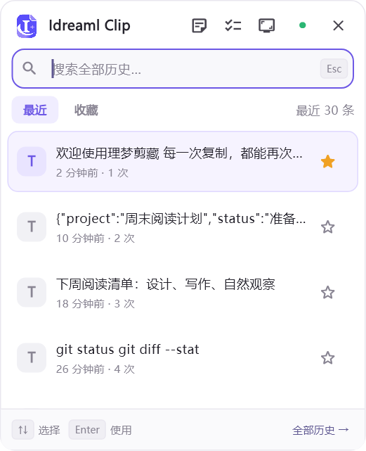
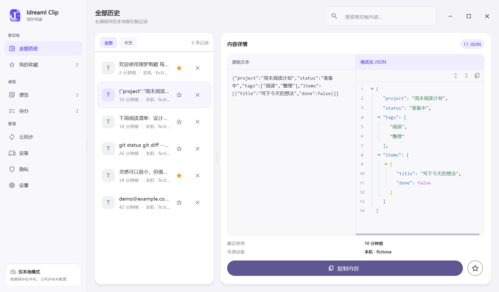
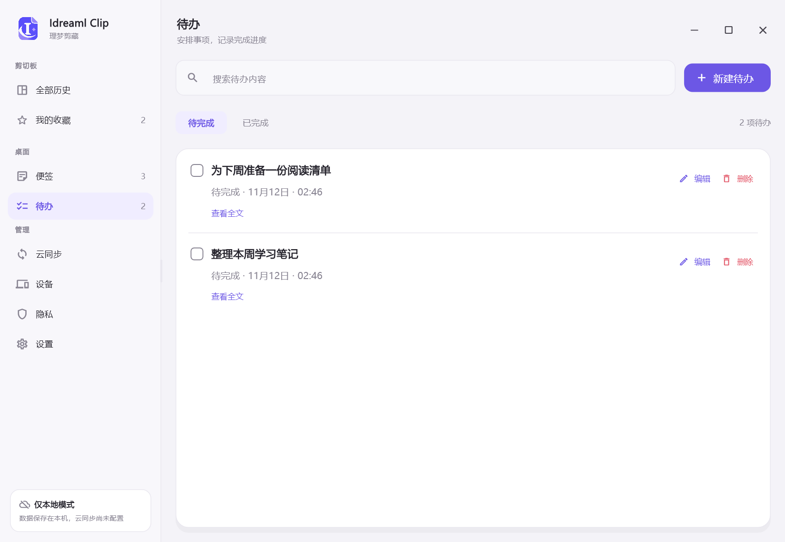

<!-- 图片固定到品牌更新提交；更换素材时同步更新提交号，避免复用旧缓存地址。 -->

  

<h1 align="center">Idreaml Clip · 理梦剪藏</h1>

找回复制过的内容，把灵感和计划留在桌面。

  <a href="https://qaqguliang.github.io/idreaml-clip/"><strong>完整图文介绍与使用指南 ↗</strong></a>
  &nbsp;·&nbsp;
  <a href="https://github.com/QaQGuliang/idreaml-clip/releases/tag/v1.1.8">下载 Windows 版</a>
  &nbsp;·&nbsp;
  <a href="docs/user-guide.md">详细使用说明</a>

理梦剪藏是一款本地优先的桌面工具，提供剪切板历史、快捷粘贴、截图与贴图，以及独立的桌面便签和待办。无需注册账号，未配置云同步也能使用。

> **[打开完整图文网站 →](https://qaqguliang.github.io/idreaml-clip/)** 通过界面截图、操作步骤和快捷键说明，了解每项功能。

## 下载

当前版本 **1.1.8+1**，支持 **Windows 10 / 11 x64**。本次仅发布 Windows 版本。

本版统一应用 Logo、托盘与系统图标，并同步更新网站、README 和使用指南中的品牌素材。

| 安装方式 | 下载与使用 |
| --- | --- |
| 安装版 | [下载 EXE 安装包](https://github.com/QaQGuliang/idreaml-clip/releases/download/v1.1.8/Idreaml-Clip-1.1.8%2B1-windows-x64-setup.exe)，按向导完成安装 |
| 便携版 | [下载 ZIP](https://github.com/QaQGuliang/idreaml-clip/releases/download/v1.1.8/Idreaml-Clip-1.1.8%2B1-windows-x64.zip)，完整解压后运行 `idreaml_clip.exe` |

运行所需组件随包提供，无需额外安装 Flutter、Dart 或 Git。便携版请保留旁边的 DLL 和 `data` 目录；升级前从托盘退出旧版并保留原数据目录。当前安装器尚未进行发布者代码签名。

[完整发布说明与 SHA-256 校验文件](https://github.com/QaQGuliang/idreaml-clip/releases/tag/v1.1.8) · [本版更新记录](assets/release-info.json)

## 能做什么

| 功能 | 用途 |
| --- | --- |
| 剪切板历史 | 自动保存文字和图片，支持搜索、收藏、去重与历史管理 |
| 快捷剪切板 | 在鼠标附近查找并使用记录，悬停预览图片和 JSON |
| 截图与取色 | 区域、窗口、全屏及跨屏截图，多种标注工具，HEX / RGB 取色 |
| 贴图与长截图 | 将截图贴在桌面参考，调整边框、位置和缩放；滚动拼接长页面 |
| 桌面便签与待办 | 固定区域展示，独立管理、完成与恢复，自定义文字和毛玻璃外观 |
| 可选 Git 同步 | 连接自己的 Gitee、GitHub 或 GitLab 仓库，跨设备同步内容 |

查看快捷剪切板与 JSON 预览

## 三步开始

1. **启动应用**，像平时一样复制文字或图片；新内容会出现在“全部历史”。
2. **点击目标输入框**，按 `Ctrl + Shift + V` 打开快捷面板，输入关键词查找内容。
3. **单击记录**，或用 `↑` / `↓` 选择后按 `Enter` 使用；按 `Esc` 收起面板。

部分应用的输入框或权限会限制自动粘贴，内容仍在剪切板时可手动按 `Ctrl + V`。关闭主窗口后，应用继续在托盘运行；左击托盘图标打开全部历史，右击选择“退出应用程序”才会完全退出。

## 常用快捷键

| 按键 | 作用与使用范围 |
| --- | --- |
| `Ctrl + Shift + V` | 打开快捷剪切板；可在设置中修改，或启用固定 `Win + V` |
| `F1` | 进入截图，也可通过快捷面板顶部的截图图标打开 |
| `F2` | 普通截图中显示或隐藏取色框，文字输入期间除外 |
| `C` | 普通截图取色框显示时复制 HEX 并结束，文字输入期间除外 |
| 单按 `F3` | 开启便签功能后，快速新建便签 |
| 快速双按 `F3` | 开启待办功能后，快速新建待办；两次间隔在 330 毫秒内 |
| `Ctrl + Enter` / `Esc` | 在 F3 或快捷面板打开的快速新增窗口中保存 / 取消 |

启用固定 `Win + V` 后，原快捷面板组合暂时停用；关闭开关后恢复。更多标注快捷键与操作边界见[详细使用说明](docs/user-guide.md)。

## 便签与待办

在 **设置 → 便签与待办** 分别启用，才会显示对应的导航、快捷面板图标和桌面列表。可指定显示器及展示区域；列表平时位于普通应用下方，`Win + D` 后仍可查看，快捷键添加时临时置顶。

| 便签 | 待办 |
| --- | --- |
|  |  |
| 记录标题与多行正文，集中搜索、编辑和删除 | 勾选完成后从桌面隐藏，在管理页查看和恢复 |

两个模块分别支持默认字体、10–32 字号和文字颜色；管理页新增或编辑可设置单条样式，也可恢复“跟随列表”。快速新增支持选色，离开快速新增窗口会保留本机草稿。

卡片采用无边框毛玻璃，背景色、渐变和透明度均可调整。100% 透明仍保留静态壁纸的模糊效果与少量底色，文字保持不透明。

## 数据与同步

- **本地独立保存**：便签和待办存入 `database/desktop.db`，不计入剪切板历史；清空历史或关闭模块不会删除这些内容。
- **按需同步**：在“云同步”连接自己的私有 Git 仓库，再分别开启便签、待办的同步开关。支持手动同步及 5、10、30 分钟定时同步。
- **内容与偏好分开**：同步便签待办内容、单条文字样式、完成和删除状态；显示器、位置、列表默认主题及草稿只保存在本机。并发修改保留双方版本，在管理页处理。
- **数据目录可迁移**：默认位于程序目录下的 `data/idreaml_clip`。在“设置 → 快捷面板与历史 → 数据存储目录”更改位置，由应用迁移并校验；备份时保留整个数据目录。

## 文档与开发

- [完整图文网站](https://qaqguliang.github.io/idreaml-clip/)：应用介绍、下载安装、界面截图与使用步骤。
- [详细使用说明](docs/user-guide.md)：功能边界、同步配置、存储迁移及其他平台的当前范围。
- [网站源码](website/) · [版本信息](assets/release-info.json)。
- [Windows 打包脚本](scripts/package-windows.ps1) · [Windows 安装器脚本](scripts/package-windows-installer.ps1)。
